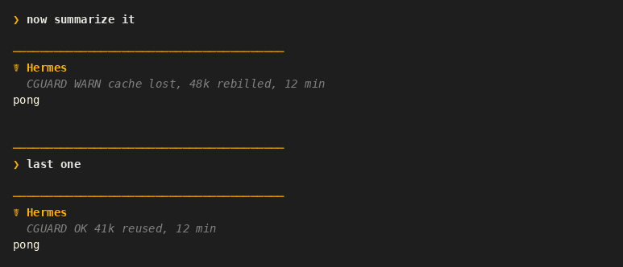
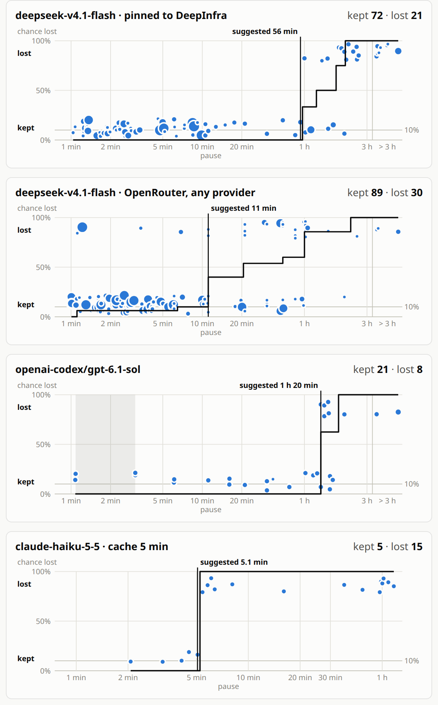

# Cacheguard

A Hermes plugin that stops you wasting money on an expired cache.

Providers bill a cache hit at a fraction of the input price: about 1/10 at Anthropic and OpenAI, 1/50 or less at Xiaomi.
After a pause, the provider may have dropped your cache. Your next message in a large chat is then billed at the full input price, or more (Anthropic charges extra to write a new cache).

cacheguard can stop it before it is sent (`block`) or tell you afterwards what was reused or rebilled (`warn`).
It learns from your own usage over time: the block text and the `/cacheguard` table show how often your cache was lost after a similar pause.
When a large chat's cache has expired, it is often cheaper to type `/new`, then ask the new chat to read back the old session by its ID.

How long a cache lives depends on the provider, the model and your Hermes config: from 5 minutes to several hours.
See [Get more from your cache](docs/guide.md#get-more-from-your-cache).

If you use the DeepSeek provider, its cache lasts 3 days to a week (measured), so this plugin makes less sense.

## Scope

- Works in: the terminal (CLI, TUI), the desktop app and Web UI, the gateway (Telegram and other messaging apps).
- Tested: CLI, TUI, desktop app, Web UI and Telegram. Editor (ACP) and other gateway platforms should work but are not tested.
- Left alone: anything that runs without you: cron, kanban, subagents, the curator, API server, webhooks, and one-shot runs (`-Q`, `--oneshot`, `-z`, so Bot Chat `-c NAME -Q` too).
- `hermes chat -q` has no screen to read the reply, so `block` acts as `warn` there.

## Install

Needs Hermes 0.22.6 or newer.

    hermes plugins install https://github.com/AIverflow/hermes-cacheguard.git --enable

Then [restart the gateway](#restart-the-gateway) and start a new chat.

Another profile: add `-p <profile>` after `hermes` in every command here, and use `~/.hermes/profiles/<profile>/` instead of `~/.hermes/`.

### Older Hermes

Hermes refuses a cacheguard version that is too new for it. Pick the version that matches your Hermes:

| cacheguard | Hermes | Git tag |
|---|---|---|
| 0.6.0 | 0.22.6 or newer | `v0.6.0` |
| 0.5.0 | 0.22.6 or newer | `v0.5.0` |
| 0.4.0 | 0.22.5 or newer | `v0.4.0` |
| 0.3.0 | 0.22.3 or newer | `v0.3.0` |
| 0.2.0 | 0.21.6 or newer | `v0.2.0` |

Hermes installs an older version by its full commit ID, not by tag:

    hermes plugins install https://github.com/AIverflow/hermes-cacheguard.git --ref c5a6380fc2754468f3b362608ddd0423045f1e35 --enable   # 0.3.0
    hermes plugins install https://github.com/AIverflow/hermes-cacheguard.git --ref 51de851525bd3d31193154bf8407c67537b6f392 --enable   # 0.2.0

Or with git: `git clone --branch v0.3.0 https://github.com/AIverflow/hermes-cacheguard.git ~/.hermes/plugins/cacheguard`. The plugin files of 0.2.0 still say 0.3.0 inside.

### Or with git

    git clone https://github.com/AIverflow/hermes-cacheguard.git ~/.hermes/plugins/cacheguard
    hermes plugins enable cacheguard
    hermes plugins adopt cacheguard

`adopt` tells Hermes where your clone came from, so `hermes plugins update` works later. Then [restart the gateway](#restart-the-gateway) and start a new chat.

## Update

    hermes plugins update cacheguard

Then [restart the gateway](#restart-the-gateway) and start a new chat.

## Restart the gateway

If a Hermes gateway runs, every chat runs its plugins inside it, even in the terminal. It does not reload plugin code by itself: restart it after you install, update, turn on or turn off cacheguard. Use the line that matches how your gateway runs:

    hermes gateway restart                   # service set up with `hermes gateway install`
    sudo systemctl restart hermes-gateway    # system service (`hermes gateway restart` does not restart it)

## Quick setup

Type `/cacheguard` to check. A new install says `(no observations yet)`. A `health: degraded` line means something is wrong.

Defaults: cli `warn`, desktop `warn`, gateway `off`. A pause is 10 minutes and a large prompt is 20k tokens.

To block first in every group after a 10-minute pause, for chats of 20k tokens or more:

    /cacheguard setup all block 10 20

Format: `setup <group|model> <mode> [pause_m] [size_k]`.

- Groups: `cli` (terminal, editor), `desktop` (desktop app, web UI), `gateway` (messaging platforms), `all`.
- Modes: `off`, `warn` (report afterwards), `block` (stop first; you send it with `/retry`).
- pause_m & size_k: they apply to every group, even when `setup` names only one.

To change only the pause, here to 1 minute:

    /cacheguard set pause_m 1

One model can have its own values. In a chat that uses it:

    /cacheguard set model mode warn

That model is then never blocked, only warned. Pause and size work too: `/cacheguard set model pause_m 5`. See [per-model settings](docs/guide.md#per-model-settings).

Two limits count items, not days. Defaults: `journal_rows 10000` (most calls kept in the stats) and `chat_files 200` (most chats that keep a tracking file). Change one with `/cacheguard set journal_rows 5000`.

## Using it

### `block`: stops before sending

Example: with `pause_m 10` and `size_k 20`, you come back after 12 minutes to a 48k-token chat. Your message is not sent. cacheguard replies:

    [CACHEGUARD] BLOCKED · 13:05 · 12 minutes pause 🕐 · ~48,000 tokens may be rebilled · lost 4 of 10 similar pauses
    To send it anyway: /retry, or send it again.
    Or start /new and paste it. Session ID: <id>

- `13:05`: when the block happened, on the clock of the machine running Hermes. The text stays in the chat, so you can tell an old block from a new one.
- `lost 4 of 10 similar pauses`: 4 of your past calls after a pause of about the same length (the same column of the `/cacheguard` table) lost the cache. It shows once there are 10 such calls.
- **Send it anyway:** type `/retry`, or send the same text again. It then goes out with no new check, however long you wait. In Telegram and other chats, `/retry` is a tappable command. In the web UI, `/retry` shows `[Message withheld: …]` as your message: the model still gets the text you typed.
- Once a message is sent, the pause clock restarts: no new block until the next pause.
- **Start over:** `/new`, then paste the message. The session ID lets the new chat read the old one back.
- After a model change the text reads `BLOCKED · 13:05 · model changed a → b · ~48,000 tokens may be rebilled`.
- **Short form:** `/cacheguard set tiny_block on` gives one line, `[CACHEGUARD] BLOCKED · 13:05 · 12m 🕐 · ~48kt · 4/10`. Start with the default text. Once you know the plugin, switch tiny on.
- **Images:** a message with an image is only warned, because `/retry` refuses images and the up arrow drops them. With `block_images on` it is blocked too: attach the image again and send it again. If Hermes first turns images into a text description (`image_input_mode: text`, models without vision), cacheguard sees plain text and treats it as text.

After you send, the result line says what happened:

- The cache was lost:

      CGUARD 13:05 cache lost, 48k rebilled, 12 min

- The cache was kept: no line by default. With `/cacheguard set display_on_success on`:

      CGUARD 13:05 41k reused, 12 min

### `warn`: sends, then tells you

The message goes out at once. The same line has `WARN` or `OK` after the time (the `OK` line, too, only with `display_on_success` on):

    CGUARD 13:05 WARN cache lost, 48k rebilled, 12 min
    CGUARD 13:05 OK 41k reused, 12 min

Switching model or provider in a large chat gives the same block (`model changed`) or line (`..., model changed`), even without a pause: the new model has no cache yet. [Details](docs/guide.md#model-change).

Small chats and short pauses stay silent. The lines are not sent to the model ([details](docs/guide.md#what-the-model-sees)). They appear as short chat notices, not as part of the model reply.

## Commands

| Command | What it does |
|---|---|
| `/cacheguard` | Every setting, and a table: how often the cache was lost, by pause length |
| `/cacheguard setup <group\|model> <mode> [pause_m] [size_k]` | Set mode, pause and size (`pause_m` and `size_k`: both or neither); `model` = the model of this chat only |
| `/cacheguard set <name> <value>` | Change one setting |
| `/cacheguard set model <pause_m\|size_k\|mode\|reset> [value]` | Own setting for the model of this chat |
| `/cacheguard help` | Every command |

## Safe by default

- cacheguard never calls the model itself, and nothing leaves your machine.
- If the plugin fails at any point, your message is still sent.

## Disclosure

- **No network, no subprocess, no model call in the plugin.** cacheguard only reads what Hermes passes to it.
- **Reads:** your `config.yaml` (its own settings).
- **Reads every message of each request, in memory:** to hash the start of the chat (only the hash is kept), and to remove its own `BLOCKED` replies, with the message before each, from what the model receives ([why](docs/guide.md#what-the-model-sees)).
- **Writes:** `<hermes home>/cacheguard/` (a journal of calls after a pause of 1 minute or more, with token counts and no session ID, and one small file per chat) and its own settings in `config.yaml` when you use `/cacheguard set` or `setup`.
- **In the repo, not in the plugin:** `scripts/` and `.github/` hold the daily compatibility check. It runs on GitHub only, never in your Hermes, and sends a Telegram alert only if its owner sets a token.
- **No message text is stored or logged.** Only counts, times, model names and a hash of the chat. The journal holds no session ID; only the chat's own small file is named after it.
- **Private Hermes names:** cacheguard uses a few (for example to read cache numbers, and to know a run has no screen). `/cacheguard` health checks them, and `hermes plugins validate` lists them.

## Turn off or remove

- Turn off, then back on:

      hermes plugins disable cacheguard
      hermes plugins enable cacheguard

- If a gateway runs, [restart it](#restart-the-gateway) after turning cacheguard off or on, or the old state stays.
- Avoid turning it off or on in the middle of a long chat: the next call may lose the cache once ([why](docs/guide.md#what-the-model-sees)).
- To hide everything but keep recording: `/cacheguard setup all off`.

To remove it:

    hermes plugins remove cacheguard
    rm -r ~/.hermes/cacheguard

The `rm` line deletes the history.

## More

The [guide](docs/guide.md) covers every setting, the estimate, unattended runs and profiles.

## Show me the data: how long the cache lasts

One user's calls, October 2026: an example, not a rule for these providers. Each dot is one call, the line is the chance the cache was lost. The same provider can behave very differently: compare DeepSeek pinned to DeepInfra with the same model on any OpenRouter provider.

## License

MIT
