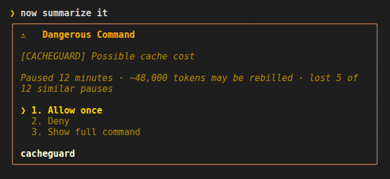
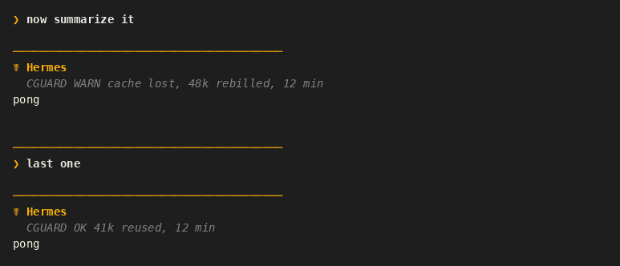
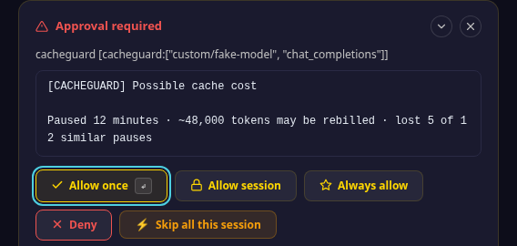
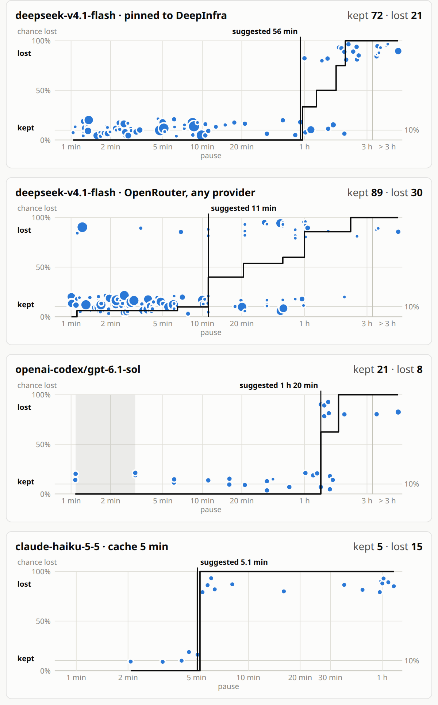

# Cacheguard

A Hermes plugin that stops you wasting money on an expired cache.

Providers bill a cache hit at a fraction of the input price: about 1/10 at Anthropic and OpenAI, 1/50 or less at DeepSeek and Xiaomi.
After a pause, the provider may have dropped your cache. Your next message in a large chat is then billed at the full input price, or more (Anthropic charges extra to write a new cache).

cacheguard can ask before sending it (`block`) or tell you afterwards what was reused or rebilled (`warn`).
It learns from your own usage over time: the box and the `/cacheguard` table show how often your cache was lost after a similar pause.
When a large chat's cache has expired, it is often cheaper to type `/new` and give the new chat the old session ID.

How long a cache lives depends on the provider, the model and your Hermes config: from 5 minutes to several hours.
See [Get more from your cache](docs/guide.md#get-more-from-your-cache).

## Scope

- Works in: the terminal (CLI, TUI), the desktop app and Web UI, the gateway (Telegram and other messaging apps).
- Left alone: anything that runs without you: cron, kanban, subagents, API server, webhooks, Bot Chat.

## Install

Needs Hermes 0.22.3 or newer. 0.22.2 builds from after 2026-10-18 work too; older ones show no result lines.

    hermes plugins install https://github.com/AIverflow/hermes-cacheguard.git --enable

Then [restart the gateway](#restart-the-gateway) and start a new chat.

Another profile: add `-p <profile>` after `hermes` in every command here, and use `~/.hermes/profiles/<profile>/` instead of `~/.hermes/`.

### Or with git

    git clone https://github.com/AIverflow/hermes-cacheguard.git ~/.hermes/plugins/cacheguard
    hermes plugins enable cacheguard
    hermes plugins adopt cacheguard

`adopt` tells Hermes where your clone came from, so `hermes plugins update` works later. Then [restart the gateway](#restart-the-gateway) and start a new chat.

## Update

    hermes plugins update cacheguard

Then [restart the gateway](#restart-the-gateway) and start a new chat.

## Restart the gateway

If a Hermes gateway runs, every chat runs its plugins inside it, even in the terminal. It does not reload plugin code by itself: restart it after you install, update, turn on or turn off cacheguard. Use the line that matches how your gateway runs:

    hermes gateway restart                   # service set up with `hermes gateway install`
    sudo systemctl restart hermes-gateway    # system service (`hermes gateway restart` does not restart it)

## Quick setup

Type `/cacheguard` to check. A new install says `(no observations yet)`. A `health: degraded` line means something is wrong. In a terminal, `hermes cacheguard` shows the same table.

Defaults: cli `warn`, desktop `warn`, gateway `off`. A pause is 10 minutes and a large prompt is 20k tokens.

To ask first (`block`) in every group after a 10-minute pause, for chats of 20k tokens or more:

    /cacheguard setup all block 10 20

Format: `setup <group> <mode> [pause_m] [size_k]`.

- Groups: `cli` (terminal, editor), `desktop` (desktop app, web UI), `gateway` (messaging platforms), `all`.
- Modes: `off`, `warn` (report afterwards), `block` (ask first).
- pause_m & size_k: they apply to every group, even when `setup` names only one.

To change only the pause, here to 1 minute:

    /cacheguard set pause_m 1

## Using it

### `block`: asks before sending

Example: with `pause_m 10` and `size_k 20`, you come back after 12 minutes to a 48k-token chat. Before your message goes out, a box asks first. It always comes down to two choices: send or don't send. Button names depend on the screen.

`lost 4 of 10 similar pauses` means: 4 of your past calls after a pause of about the same length (the same column of the `/cacheguard` table) lost the cache. It shows once there are 10 such calls.

- **Don't send** (`Cancel`, `Deny`), or no answer within 5 minutes (Hermes' `approvals.timeout`): nothing is sent. Your message stays on screen, but the model never gets it. You see:

      [CACHEGUARD] BLOCKED · message not sent after a pause of 12 minutes (cancelled)
      Send it again, or start /new and paste it. Session ID: <id>

- **Send** (`Send message`, `Allow once`): the message is sent. Then one line says what happened:
  - The cache was lost:

        CGUARD cache lost, 48k rebilled, 12 min

  - The cache was kept: no line by default. With `/cacheguard set display_on_success on`:

        CGUARD 41k reused, 12 min

### `warn`: sends, then tells you

No box: the message goes out at once. The same line has `WARN` or `OK` after `CGUARD` (the `OK` line, too, only with `display_on_success` on):

    CGUARD WARN cache lost, 48k rebilled, 12 min
    CGUARD OK 41k reused, 12 min

Switching model or provider in a large chat gives the same box (`Model changed`) or line (`..., model changed`), even without a pause: the new model has no cache yet. [Details](docs/guide.md#model-change).

Small chats and short pauses stay silent. The lines are not sent to the model ([details](docs/guide.md#what-the-model-sees)). They appear as short chat notices, not as part of the model reply.

### Web UI

The same box, as an approval card:

Extra buttons: **Allow session** and **Always allow** just send. **Skip all this session** sends too, but it turns off every Hermes approval for this session.

## Commands

| Command | What it does |
|---|---|
| `/cacheguard` | Table: how often the cache was lost, by pause length |
| `/cacheguard setup <group> <mode> [pause_m] [size_k]` | Set mode, pause and size (`pause_m` and `size_k`: both or neither) |
| `/cacheguard set <name> <value>` | Change one setting |
| `/cacheguard help` | Every command |

## Safe by default

- cacheguard never calls the model itself, and nothing leaves your machine.
- If the plugin fails at any point, your message is still sent. Only a Cancel you already gave stays not sent. If the box itself fails, or Hermes answers in a form cacheguard does not know, cacheguard only warns until Hermes restarts.

## Turn off or remove

- Turn off, then back on:

      hermes plugins disable cacheguard
      hermes plugins enable cacheguard

- If a gateway runs, [restart it](#restart-the-gateway) after turning cacheguard off or on, or the old state stays.
- Avoid turning it off or on in the middle of a long chat: the next call may lose the cache once ([why](docs/guide.md#what-the-model-sees)).
- To hide everything but keep recording: `/cacheguard setup all off`.

To remove it:

    hermes plugins remove cacheguard
    rm -r ~/.hermes/cacheguard

The `rm` line deletes the history.

## More

The [guide](docs/guide.md) covers every setting, the estimate, unattended runs and profiles.

## Show me the data: how long the cache lasts

One user's calls, October 2026: an example, not a rule for these providers. Each dot is one call, the line is the chance the cache was lost. The same provider can behave very differently: compare DeepSeek pinned to DeepInfra with the same model on any OpenRouter provider.

## License

MIT
